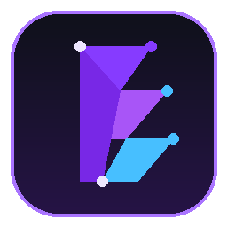
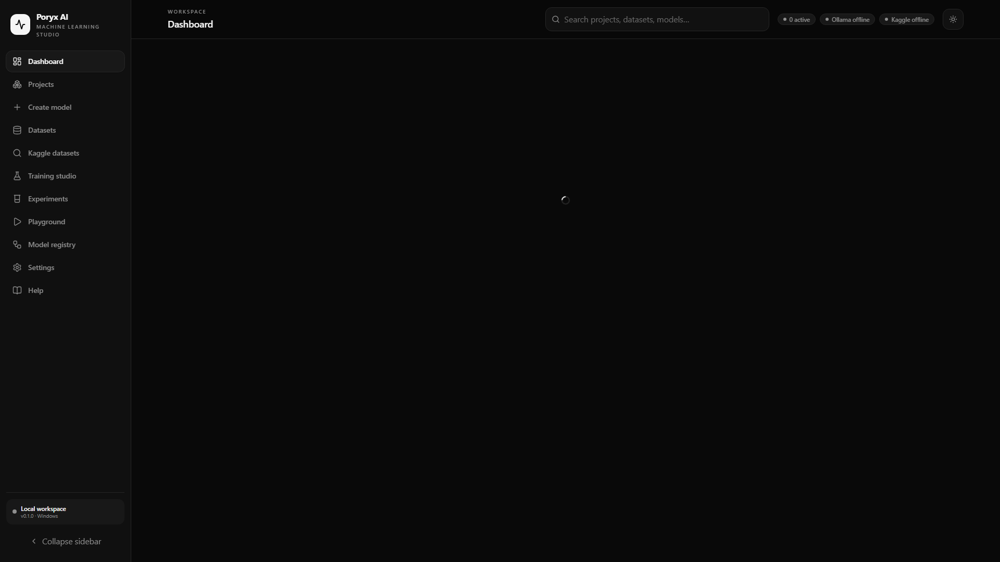
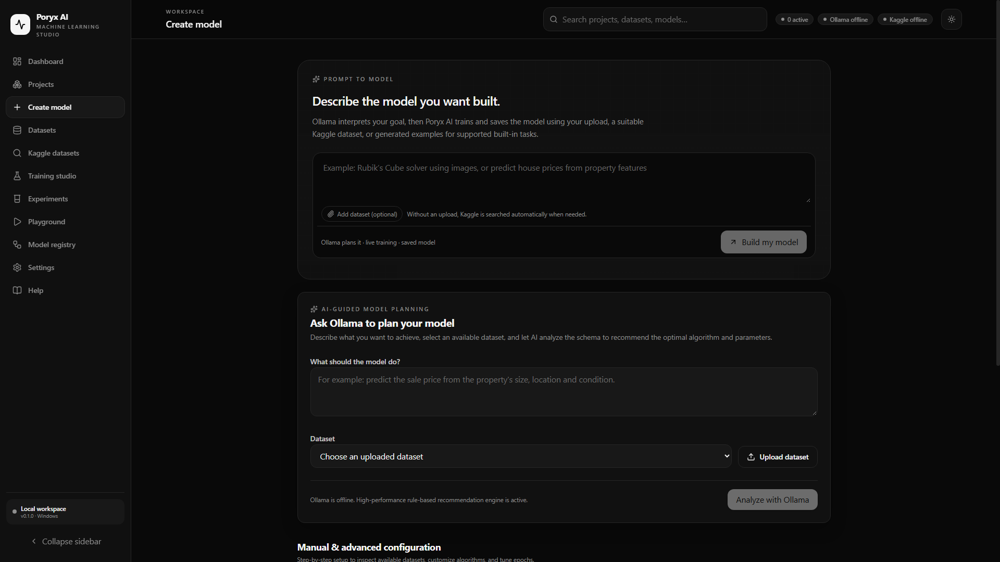
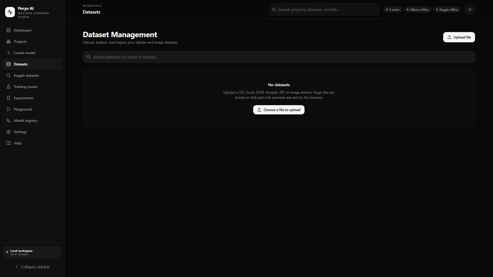
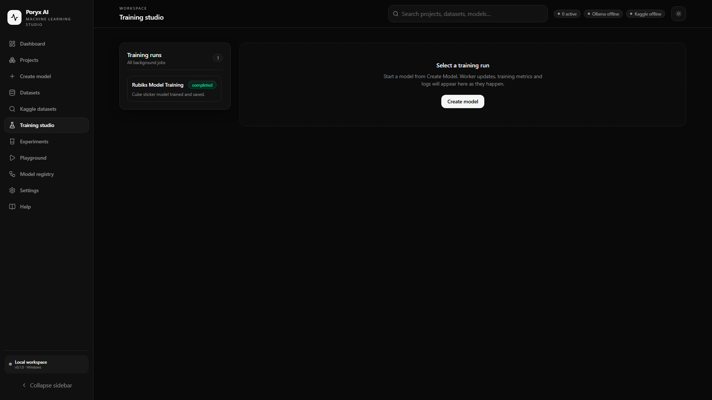
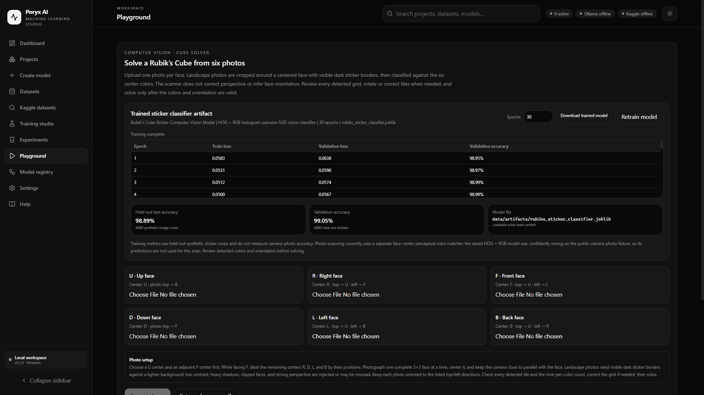
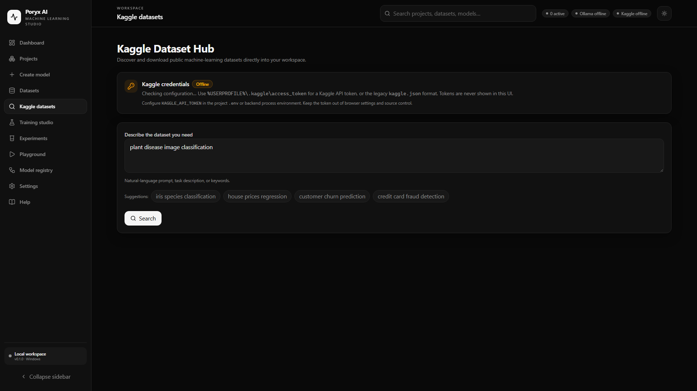

<div align="center">



# Poryx AI
### Free, Private, Local Machine Learning & AI Model Development Studio

[](https://github.com/sherlock-dev-ai/Poryx-AI---FREE-AI-model-builder)
[](https://www.python.org/)
[](LICENSE)
[](http://127.0.0.1:8000)
[](#privacy--security-first)

**Poryx AI** is a professional, browser-native desktop AI engineering platform designed for rapid dataset exploration, AI-assisted model architecture planning, automated training, and real-time model experimentation—running entirely on your local machine.

[Key Features](#key-features) • [Application Preview](#application-preview) • [Quick Start](#quick-start-running-on-localhost) • [Training Architecture](#machine-learning-architecture--training-workflow) • [Integrations](#integrations-guide) • [Hardware Specs](#system-requirements)

</div>

---

## Overview

Most modern machine-learning workflows force a compromise: either wrestling with complex, fragmented terminal environments, or uploading sensitive enterprise data to third-party cloud platforms.

**Poryx AI provides a third way:**
An integrated, polished development studio operating entirely over `http://127.0.0.1:8000`. You get a clean visual canvas for dataset profiling, automated algorithm recommendation, live training metric visualization, and real-time inference testing—backed by local Python machine-learning runtimes and local LLMs (via Ollama) without a single byte of proprietary training data leaving your workstation.

---

## Key Features

- **Localhost Web Studio (No Heavy Electron Apps or Installer Hell)**:
  Runs directly in your preferred web browser (Chrome, Edge, Firefox, Brave) backed by high-throughput FastAPI and React 19 single-page application.
- **Natural Language "Prompt to Model"**:
  Describe your objective in plain English (e.g., *"Predict customer churn from subscription events"* or *"Classify musical genres from acoustic features"*). Local LLMs analyze your intent, extract task parameters, and draft a complete ML training plan.
- **Pre-Training Dataset Profiler**:
  Automatic inspection for CSV, Parquet, and image directories. Visual cards highlight record counts, feature dimensions, missingness ratios, target label suitability, and task-specific recommendation badges (`⭐ Recommended for this task`).
- **Algorithm Comparison & Task Recommendation**:
  Compare estimators across tree-based ensembles, gradient boosting, and linear families. Real-time capability tags highlight advantages (*Robust to Outliers*, *Interpretable Weights*, *Non-linear Boundaries*).
- **Interactive Epoch Presets**:
  Take the guesswork out of training duration with calibrated presets:
  - `⚡ Fast (5 epochs)` — Rapid baseline verification.
  - `⚖️ Balanced (20 epochs) [Recommended]` — Optimal bias-variance balance.
  - `🎯 Deep Training (50 epochs)` — Maximum representation learning for rich datasets.
- **Live Training Engine & Diagnostic Curves**:
  Observable training workflows with Recharts loss/accuracy curves, live stage progress steppers, real-time elapsed timers, and complete raw execution logs.
- **Interactive Model Playground & Computer Vision**:
  Test your trained `.joblib` estimators immediately with dynamic feature sliders, batch inference tables, and Singmaster Rubik's Cube state solvers with step-by-step move playback.
- **Kaggle Hub & Dataset Ingestion**:
  Direct discovery and seamless background downloading of Kaggle public datasets with token-authenticated requests.
- **Privacy & Security First**:
  Zero cloud analytics, zero telemetry. All weights, data rows, SQLite metadata, and `.env` credentials stay firmly on your local disk.

---

## Application Preview

### 1. Unified Dashboard
A central command center displaying workspace metrics, active training workers, recent model evaluations, storage usage, and local Ollama service health.

<div align="center">
  
</div>

---

### 2. Model Creation Studio (Pre-Flight Inspection & Epoch Presets)
Inspect candidate datasets, select prediction targets, configure problem types, and choose from recommended training intensities before launching training.

<div align="center">
  
</div>

---

### 3. Dataset Explorer & Schema Inspector
Comprehensive tabular previews with sticky headers, column datatype distributions, and missing-value density bars.

<div align="center">
  
</div>

---

### 4. Live Training Studio
Track job progress stage by stage, monitor real-time convergence curves, inspect training parameters, and verify generated artifact directories.

<div align="center">
  
</div>

---

### 5. Model Playground & Real-Time Inference
Interact with trained models using dedicated feature sliders, test held-out samples, and visualize heuristic problem solvers with interactive 3D step-by-step solutions.

<div align="center">
  
</div>

---

### 6. Kaggle Dataset Hub
Search through millions of public datasets directly from within Poryx AI, inspect dataset metrics, and pull them straight into your local workspace.

<div align="center">
  
</div>

---

## Quick Start (Running on Localhost)

Poryx AI is engineered for immediate execution without complex installation wizards.

### Method 1: Homescreen Shortcut (Recommended)
Double-click the **Poryx AI** shortcut placed on your Windows Desktop. It automatically starts local services and opens `http://127.0.0.1:8000` in your browser.

### Method 2: One-Click Batch Launcher
Double-click `start-localhost.bat` in your project folder:
```cmd
L:\Poryx AI\start-localhost.bat
```

### Method 3: PowerShell Script
```powershell
powershell -ExecutionPolicy Bypass -File scripts\start-localhost.ps1
```
> For live frontend development with Vite HMR:
> ```powershell
> powershell -ExecutionPolicy Bypass -File scripts\start-localhost.ps1 -Dev
> ```

### Method 4: Direct Python Execution
```bash
# Navigate to the project root
cd "Poryx AI"

# Launch the unified server
backend\.venv\Scripts\python.exe scripts\desktop_launcher.py --port 8000
```
Open **[http://127.0.0.1:8000](http://127.0.0.1:8000)** in your browser.

---

## Machine Learning Architecture & Training Workflow

```mermaid
flowchart LR
    A["Raw Data (CSV / Parquet / Images)"] --> B["Pre-Flight Profiler"]
    B --> C["Task & Target Detection"]
    C --> D["Algorithm Selector (Ensembles / Boosters / Linear)"]
    D --> E["Epoch Presets (Fast / Balanced / Deep)"]
    E --> F["Local Background Worker"]
    F --> G["Live Training Monitor (Loss & Accuracy Curves)"]
    G --> H["Model Artifacts (.joblib & Python Source)"]
    H --> I["Playground (Live Inferences)"]
```



### Supported Estimator Families
- **Tabular Classification & Regression**:
  - Gradient Boosted Decision Trees (`Histogram Gradient Boosting`, `GradientBoostingClassifier/Regressor`)
  - Random Forest Ensembles (`RandomForestClassifier/Regressor`)
  - Regularized Linear Models (`Ridge`, `Lasso`, `LogisticRegression`)
  - Decision Trees (`DecisionTreeClassifier/Regressor`)
- **Unsupervised Learning & Clustering**:
  - K-Means Clustering (`KMeans` with inertia diagnostics)
- **Computer Vision & Pattern Recognition**:
  - Feature extraction classifiers (`HOG + Color Histogram`)
  - Singmaster Two-Phase Heuristic Solvers for combinatorial puzzle states

---

## Integrations Guide

### 1. Kaggle API Token Setup
To enable in-app dataset search and automatic downloads:
1. Navigate to **[Kaggle Account Settings](https://www.kaggle.com/settings/api)**.
2. Click **Generate New Token** (or copy your API Access Token).
3. Open or create the `.env` file in the project root:
   ```env
   KAGGLE_API_TOKEN=KGAT_your_token_here
   ```
4. Save the file. Poryx AI automatically detects the token without requiring a restart.

### 2. Ollama Integration (Local AI Architecture Planning)
Poryx AI leverages local LLMs for natural language model planning and code generation:
1. Install [Ollama](https://ollama.com/) on your workstation.
2. Pull your model of choice (recommended: `qwen2.5:3b`, `llama3.1:8b`, or `mistral`):
   ```bash
   ollama pull qwen2.5:3b
   ```
3. Poryx AI automatically links to `http://127.0.0.1:11434` and displays local AI availability directly on the status bar.

---

## Privacy & Security First

- **Isolated Execution**: All background workers and SQLite databases bind exclusively to `127.0.0.1`.
- **Zero Credential Exposure**: Tokens configured in `.env` are masked in logs and never serialized over the network.
- **Reproducible Artifacts**: Every completed training run exports both the serializable model weights (`.joblib`) and the standalone Python training script (`.py`), ensuring your models remain completely decoupled and portable.

---

## System Requirements

| Component | Minimum Specification | Recommended Specification |
| :--- | :--- | :--- |
| **Operating System** | Windows 10 / 11 (64-bit) | Windows 11 (64-bit) |
| **Processor** | 4-Core Intel Core i5 / AMD Ryzen 5 | 8-Core Intel Core i7 / AMD Ryzen 7 or higher |
| **Memory** | 8 GB RAM | 16 GB RAM or higher |
| **Storage** | 2 GB available disk space | SSD with 10 GB+ for datasets & model artifacts |
| **Python** | Python 3.11+ | Python 3.11.x 64-bit |
| **Browser** | Modern Chromium / Firefox / WebKit | Google Chrome, Brave, or Microsoft Edge |

---

## Project Structure (Distribution View)

```
Poryx AI/
├── assets/                  # High-resolution application icons and brand assets
│   └── poryx.ico            # Multi-layer Windows application icon
├── docs/
│   └── images/              # High-resolution interface previews & diagrams
│       ├── dashboard.png
│       ├── create_model.png
│       ├── datasets.png
│       ├── training.png
│       ├── playground.png
│       └── kaggle.png
├── scripts/
│   ├── desktop_launcher.py  # Localhost web server & process controller
│   ├── start-localhost.ps1  # Automated PowerShell startup script
│   └── create_desktop_shortcut.ps1 # Homescreen shortcut manager
├── start-localhost.bat       # 1-Click double-clickable desktop batch launcher
├── LICENSE                  # MIT Open Source License
└── README.md                # Comprehensive documentation
```

---

## Contributing & Development

Contributions, feature suggestions, and bug reports are welcome. Feel free to open an issue or submit a pull request on the repository.

1. Fork the Project
2. Create your Feature Branch (`git checkout -b feature/AmazingFeature`)
3. Commit your Changes (`git commit -m 'Add some AmazingFeature'`)
4. Push to the Branch (`git push origin feature/AmazingFeature`)
5. Open a Pull Request

---

## License

Distributed under the **MIT License**. See [`LICENSE`](LICENSE) for full details.

---

<div align="center">
  <sub>Engineered with precision by <b>sherlock-dev-ai</b>. Built for fast, private, zero-compromise local machine learning.</sub>
</div>
